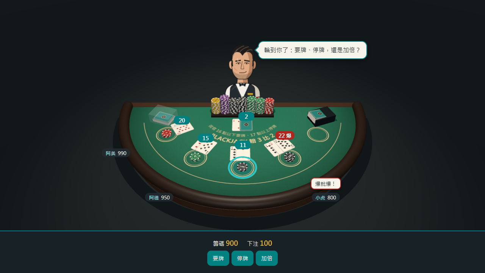

<!-- 職責：給同事看的遊戲說明（去哪玩、怎麼玩、已知限制、驗到什麼程度）。型別：從頭讀型，上限 400 行。實作細節與量測數字不寫這裡，見 CLAUDE.md 與 docs\。 -->

# 21 點

在瀏覽器裡玩的 21 點：一位荷官、三位電腦同桌，籌碼只是遊戲點數。

## 去哪玩

1. 上線後的網址是 `https://sodack87.github.io/Game---Blackjack/`，用 Edge 或 Chrome 打開就能玩，不用安裝（還沒上線）。
2. 不連網也能玩：把整個資料夾複製到電腦上，雙擊 `app\index.html`。

手機也能玩，直拿或橫拿都可以。

## 怎麼玩

1. 按 +10、+50、+100、+500 疊出這一局要下的注，按「發牌」。下一局會先幫你填上一局的注。
2. 輪到你時，你的下注圈會亮起藍圈，荷官也會提醒你。按「要牌」「停牌」或「加倍」。
3. 荷官翻開底牌、補完牌就結算：贏的籌碼飛回你面前，輸的被收走，平手原樣退回。
4. 籌碼輸光時，按「重新開始」補回 1,000。

## 規則

1. 目標是手上的牌比荷官更接近 21 點，但不能超過，超過叫「爆牌」，直接輸。
2. 2 到 10 照牌面算，J、Q、K 算 10 點，A 可以算 1 點或 11 點。
3. 每局先下注（10 到 1,000，以 10 為單位），再發兩張牌。輪到你時可以要牌、停牌，或加倍（只有頭兩張時能加倍：賭注加倍，只再拿一張）。
4. 要到 21 點會自動停牌。
5. 荷官的明牌是 A 或 10 點牌時會先偷看底牌，如果是 Blackjack 就直接結算，你不必再做決定。
6. 荷官的牌到 17 點以上就停牌（A 加 6 的 17 點也停）。
7. 頭兩張就是 21 點（A 加一張 10 點牌）叫 Blackjack，贏 1.5 倍；跟荷官同點數則退回賭注。
8. 用 6 副牌，發到大約四分之三就重新洗牌。

## 同桌的三位

| 名字 | 個性 | 打法 |
| --- | --- | --- |
| 小虎 | 莽撞 | 16 點以下都要牌，9 到 11 點一律加倍，下注大 |
| 阿德 | 穩健 | 照 21 點的基本策略打，長期輸得最少 |
| 阿美 | 膽小 | 12 點就停、從不加倍，只下最低注 |

他們的籌碼輸光會自己再買，不會離桌。

## 籌碼存在哪

存在這台電腦的瀏覽器裡：關掉再開，籌碼還在。換電腦、換瀏覽器、用無痕視窗，或清除瀏覽器的網站資料，就會從 1,000 重新開始。

## 已知限制

1. 沒有分牌、保險、投降，也沒有音效。
2. 只在 Windows 11 的 Edge 與 Chrome 上驗過。手機版面是在電腦上模擬手機尺寸驗的，還沒有在真的手機上玩過。

## 狀態

v0.6.0（2026-10-22）：自動檢查 82 項全部通過（Windows 11，Edge 與 Chrome），包含自動對打、規則、版面與存檔。
